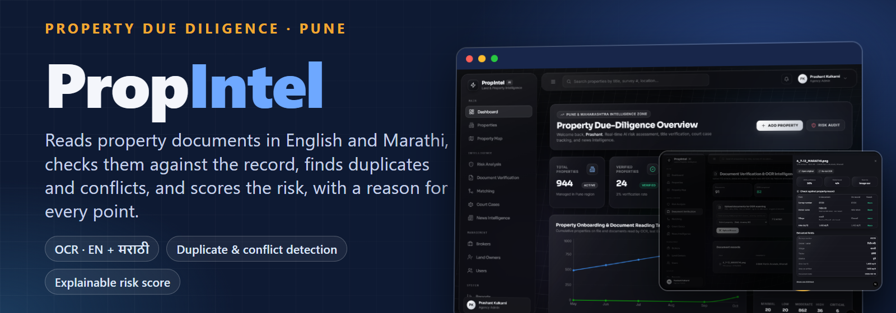
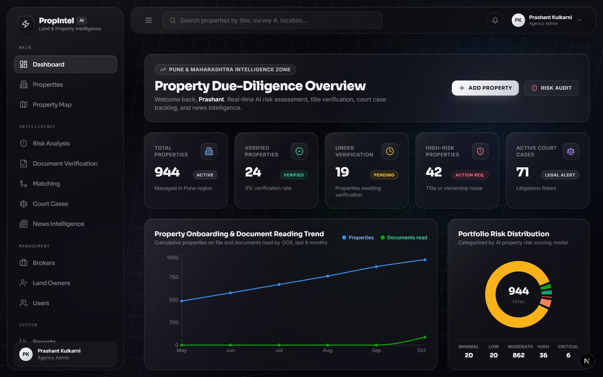
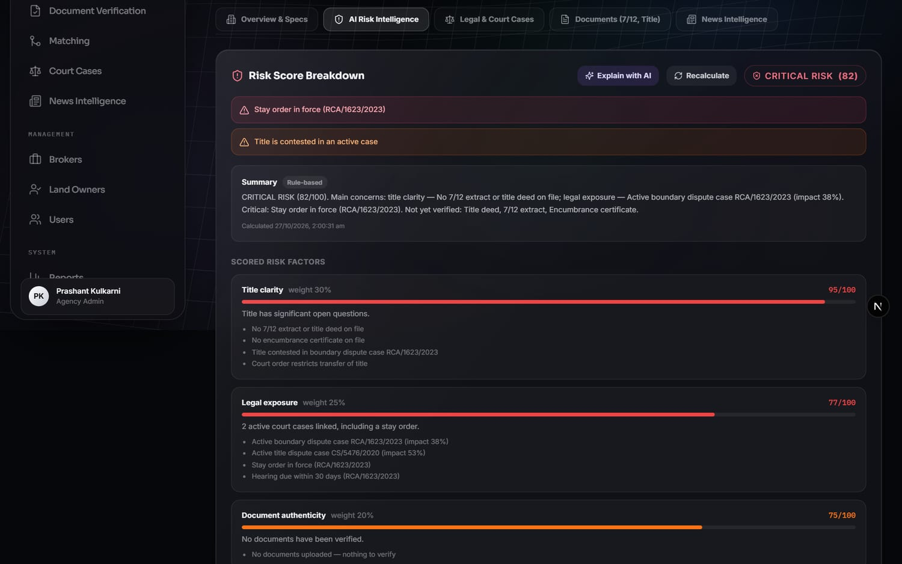
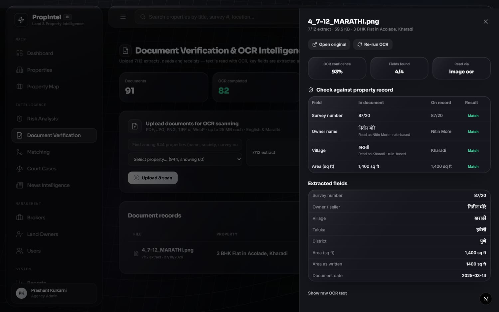
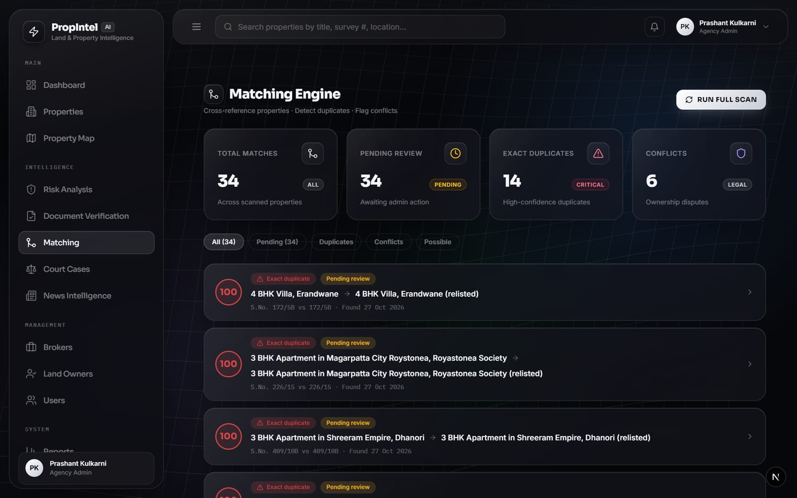
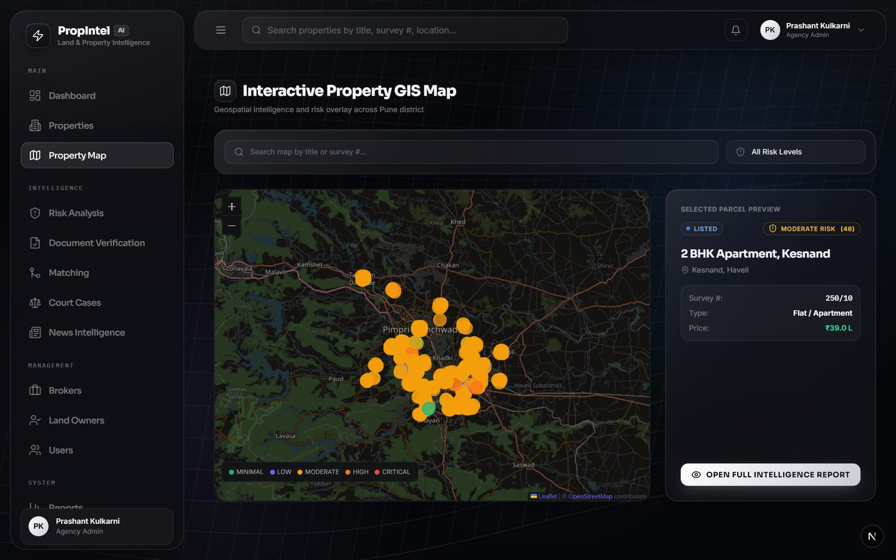
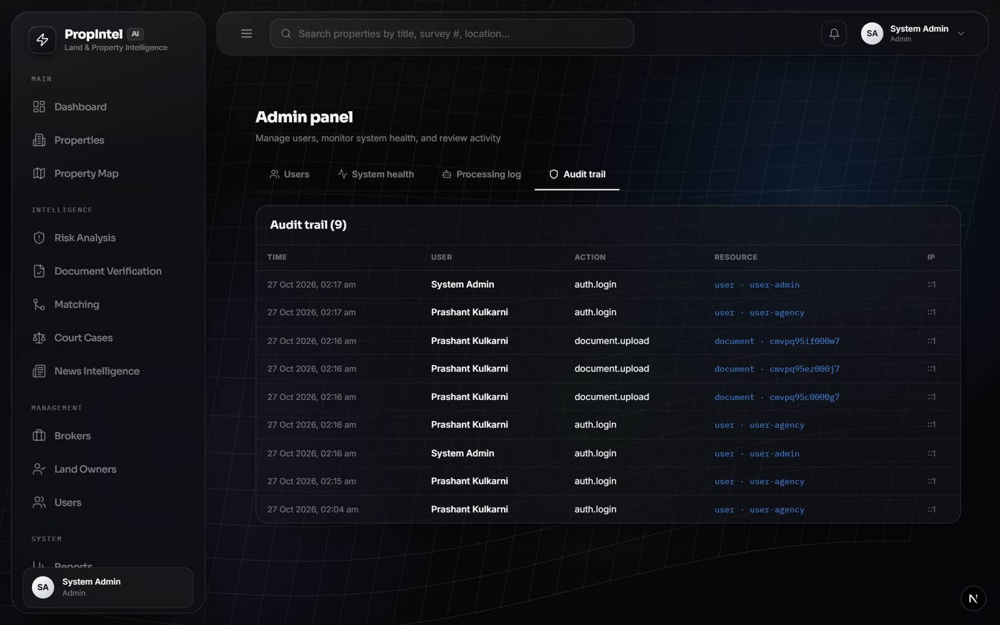

<p align="center">
  
</p>

<h1 align="center">PropIntel</h1>
<p align="center"><b>Property intelligence for Pune: read the documents, check the record, score the risk — and show why.</b></p>

<p align="center">
  <a href="https://github.com/abhee7/property-intelligence-pune/actions/workflows/ci-cd.yml"></a>
  
  
  
  
  
  
</p>

<p align="center">
  <a href="#quick-start">Quick start</a> ·
  <a href="#what-it-does">Features</a> ·
  <a href="#screenshots">Screenshots</a> ·
  <a href="#how-the-risk-score-works">Risk score</a> ·
  <a href="docs/PropIntel_Project_Report.pdf">Project report</a> ·
  <a href="DEMO.md">Demo script</a>
</p>

---

## Why

Buying land or a flat in Pune means trusting documents — the 7/12 extract, the title deed, the encumbrance
certificate. The common frauds (the same plot listed twice, one plot claimed by two owners, a document that
belongs to a different property, a title frozen by a court stay order) show up only when pieces of
information are **compared**. PropIntel does that comparison automatically, in English and Marathi, and
explains every point of its conclusion.

## Highlights

- **Reads Marathi and English documents** with OCR, then checks owner, village, survey number and area against the record. A Marathi 7/12 can be verified against an English record.
- **Never accuses on a shaky scan** — low-confidence fields are held back for manual review instead of being reported as mismatches.
- **Finds duplicates and ownership conflicts** across the whole portfolio, treating the survey number as the legal identifier.
- **Explainable 0–100 risk score** from five weighted factors, with hard floors (stay order, fraud case, confirmed duplicate) and the evidence for every point.
- **Optional AI** (off without a key): plain-English explanations, re-reading of poor scans, Marathi name spelling — it can never change a score.
- **Reproducible**: one command installs it, a seeded dataset gives the same demo on every machine, 402 automated tests.


A due-diligence tool for buying land and flats in **Pune, Maharashtra**. Upload a property's
documents (7/12 extracts, title deeds, sale deeds…) and PropIntel reads them with OCR, checks
them against the property record, looks for duplicate or conflicting listings, and combines
that with court cases and news into a **0–100 risk score** — with the evidence behind every point.

> **Status: working prototype.** The document reading, verification, matching and risk scoring
> are real and tested. The external data sources (court records, land records, news) and
> notifications are **not** connected to live services — see [Limitations](#limitations).

---

## What it does

| Feature | How it works |
|---|---|
| **Document OCR** | Upload a PDF or image. Digital PDFs are read directly; scans go through [Tesseract](https://github.com/naptha/tesseract.js) (English first, English + Marathi as a fallback) after speckle removal and contrast cleanup. Runs fully offline. *Optionally,* an AI model (Gemini or Claude) re-reads scans Tesseract is unsure about ([AI features](#ai-features-optional)). |
| **Field extraction** | Pulls survey number, owner, village, taluka, area (converts guntha / acre / hectare / `H.R` to sq ft), date, registration number and amount — English and Marathi labels, Devanagari digits, OCR debris stripped. |
| **Verification** | Compares each extracted field with the property record and reports *match / partial / mismatch / can't compare* — including Marathi (Devanagari) owner names and villages against the English record, by transliteration and phonetic matching. Warns if a document isn't the type it was uploaded as, or describes a *different* property. A shaky scan never produces a false accusation — those fields are held back for manual review. |
| **Duplicate & conflict matching** | Compares every pair of properties on survey number (35%), owner (25%), village (15%), area, price and coordinates. Flags exact/likely duplicates and **ownership conflicts** (same survey number, different owner). Reviewers confirm or dismiss; decisions persist. |
| **Risk scoring** | Five weighted factors, each with evidence — see [How the risk score works](#how-the-risk-score-works). Recalculates automatically when anything feeding it changes. |
| **Court cases & news** | Cases (with hearings, parties, stay orders) and newspaper mentions are linked to properties and feed the score. |
| **Map, analytics, dashboard** | Leaflet map of all properties coloured by risk; portfolio dashboard (risk distribution, talukas, onboarding trend, high-risk watchlist, latest activity), all computed from the database. |
| **Alerts** | When a property's risk rises to High or Critical, its owner, broker and the agency admins get an in-app alert (bell in the header + Notifications page). |
| **Admin** | Platform admin can list and (de)activate users, see system health and documents needing attention, and read the **audit trail** (logins, uploads, deletions, match decisions, property creation, user changes). |
| **Auth & roles** | JWT access/refresh tokens, bcrypt, role-based access (admin, agency admin, broker, land owner), multi-tenant data isolation. |

## Screenshots

| | |
|---|---|
| <br><sub>**Dashboard** — every chart is computed from the database</sub> | <br><sub>**Risk intelligence** — a Critical (82) property with its evidence</sub> |
| <br><sub>**Marathi 7/12** verified against the English record</sub> | <br><sub>**Matching** — duplicates, conflicts and possible matches</sub> |
| <br><sub>**Map** — 944 properties coloured by risk</sub> | <br><sub>**Admin** — audit trail of logins, uploads and decisions</sub> |

## Documentation

| | |
|---|---|
| [Project report](docs/PropIntel_Project_Report.pdf) | Design, implementation, testing, limitations (editable `.docx` alongside) |
| [Demo script](DEMO.md) | A 15-minute walkthrough with the exact values to expect |
| [Viva preparation](docs/VIVA_PREP.md) | Likely questions and honest answers |
| [Dataset notes](data/pune-real-estate/README.md) | What is real and what is generated |
| [Diagrams](docs/figures) | Architecture, pipeline, risk engine, matching, Marathi comparison, database |

## Tech stack

Next.js 15 (App Router) · React 19 · TypeScript · Tailwind CSS · Prisma 6 + SQLite ·
tesseract.js · pdfjs-dist · sharp · Leaflet · Recharts · Zod · Vitest · optional AI: Google Gemini (`@google/genai`) or Claude (`@anthropic-ai/sdk`)

---

## Quick start

**Needs:** Node.js 18+ (tested on 24). Python 3 is only needed to re-download the dataset.

```bash
git clone <this repo> && cd propintel
bash scripts/setup.sh
npm run dev
```

Open <http://localhost:3000> and sign in with one of the demo accounts below.

`setup.sh` installs dependencies, creates `.env`, builds the database, seeds users, downloads the
OCR language data (~12 MB), imports the Pune dataset and runs the sample documents through OCR
(about a minute). Use `bash scripts/setup.sh --no-dataset` for a faster, smaller setup.

<details>
<summary>Doing it by hand (e.g. on Windows without bash)</summary>

```bash
npm install
copy .env.example .env          # cp on macOS/Linux
npx prisma generate
npx prisma db push
npm run db:seed                 # users, roles, document types — run once on an empty database
npm run ocr:setup               # OCR language data
npm run dataset:import          # Pune dataset (backs up the database first)
npm run dataset:documents       # sample documents → real OCR
npm run dev
```
</details>

### With Docker

No Node, Python or database setup needed — just Docker (Compose v2).

```bash
docker compose up --build
```

Then open <http://localhost:3000>. The **first run takes several minutes**: it builds the images (downloading the
OCR language data once), then a one-shot `init` service creates the database, seeds the users, imports the Pune
dataset and runs the sample documents through OCR. Later starts take seconds.

| | |
|---|---|
| `INIT_DATASET=0 docker compose up --build` | Skip the dataset for a much faster first start (base demo data only) |
| `docker compose logs init` | Watch / review the first-run setup |
| `docker compose down` | Stop. Your data is kept in the `propintel-data` volume |
| `docker compose down -v` | Stop **and delete** the database and all uploaded documents |
| `PORT=8080 docker compose up` | Serve on another port |

How it is put together: one image serves the app (Next.js "standalone" build on Debian), a second image from the same
Dockerfile runs the setup, and a single volume `/data` holds the SQLite database, uploaded documents and the OCR cache —
so nothing is lost when containers are rebuilt. OCR language data is baked into the image, so scanning works offline.
Secrets are never copied into an image: pass `JWT_ACCESS_SECRET`, `JWT_REFRESH_SECRET` and (optionally)
`GEMINI_API_KEY` (or `ANTHROPIC_API_KEY`) through your shell or a `.env` file next to `docker-compose.yml`. **Set real JWT secrets** outside local use.

> **Verified.** `docker compose up --build` was run from an empty volume on Docker Desktop 4.77 (Windows, Linux
> engine): the images built, the one-shot setup imported 944 properties and read 88 sample documents with OCR (about
> 80 s), and the app came up healthy. Against the running container: login, the data, and OCR of an image, a scanned
> PDF and a digital PDF all worked, and uploaded files are served back from the volume. After `docker compose down` and
> `up` (no rebuild) nothing was lost and the restart took about 8 seconds. Needs internet access at build time (OCR
> language data download). CI builds both images on every push.

### Demo accounts

Local, seeded demo users — password for all: `Demo@12345`

| Email | Role |
|---|---|
| `manager@sahyadri-demo.com` | Agency admin — **use this one** |
| `admin@sahyadri-demo.com` | Platform admin |
| `broker@sahyadri-demo.com` | Broker |
| `owner@sahyadri-demo.com` | Land owner |

The login page also has one-click buttons for these.

---

## How it fits together

```
 upload ──► storage ──► OCR job queue ──► extract fields ──► verify against record
                           (one at a time)                          │
                                                                    ▼
 court cases ─┐                                   cross-check: does it fit another property?
 news ────────┤                                                    │
 matches ─────┼──────────────► risk engine ◄───────────────────────┘
 documents ───┘             (5 factors → score + evidence)
                                   │
              recalculated automatically when a document is read,
              a match is reviewed, or a property changes
```

```
src/
  app/                    pages (dashboard) and API routes
  modules/
    documents/ocr/        ocr.engine · field-extractor · verification · ocr.service
    matching/             algorithms (pure) · service (database)
    risk/                 risk.engine (pure) · risk.service (database)
    dataset/              Pune dataset parsing and scenario planning (pure)
    properties/ analytics/ notifications/ admin/
  lib/                    auth, database client, storage, validation
prisma/                   schema, seed, dataset importer, sample-document generator
data/pune-real-estate/    the dataset + a README on what is real vs generated
scripts/                  setup, downloads, smoke tests, demo helpers
__tests__/                unit, integration and e2e tests
```

The scoring and matching logic lives in **pure functions** (no database), which is why it is
thoroughly unit-tested.

## How the risk score works

Each property gets five factor scores (0 = no concern, 100 = severe). The overall score is their
weighted average, then adjusted:

| Factor | Weight | Looks at |
|---|---|---|
| Title clarity | 30% | 7/12 or title deed on file, survey number, title disputes, stay orders, duplicate/conflict matches, survey number mismatches in documents |
| Legal exposure | 25% | Active court cases by type (fraud > title > boundary…) and impact, stay orders, upcoming hearings, disposed cases |
| Document authenticity | 20% | Missing mandatory documents, failed/low-confidence scans, field mismatches, wrong document type, document for a different property |
| Ownership stability | 15% | Owner on record, owner named in documents, ownership-conflict matches |
| News sentiment | 10% | Relevant negative / positive newspaper coverage |

**Adjustments**

- **Unverified penalty (up to +15):** a property with no verified mandatory documents is not "safe", it is *unknown*.
- **Hard floors:** an active stay order → at least 60 (High); an active fraud case → at least 70; a confirmed duplicate/conflict → at least 65.

**Levels:** 0–15 Minimal · 16–35 Low · 36–55 Moderate · 56–75 High · 76–100 Critical.

Every factor stores its evidence (e.g. *"Active title dispute case MA/9000/2021 (impact 72%)"*), shown
on the property's **AI Risk Intelligence** tab. Tenants can override the weights in
`TenantSettings.riskWeights`. By default the narrative text is generated from the rules; with an AI key (Gemini or Claude)
you can have the model write it instead — see [AI features](#ai-features-optional).

---

## AI features (optional)

PropIntel works fully without any AI. Add an API key — **Google Gemini** or **Anthropic Claude**, your choice — and three
things get better, all clearly labelled in the UI, and all falling back silently to the built-in behaviour if anything
goes wrong (no key, API down, a refusal, a bad answer).

| | What the AI model does | What it never does |
|---|---|---|
| **Risk narrative** | Explains a property's score in plain English with suggested next steps ("Explain with AI" on the risk tab). | Score anything. The rules compute the score; the model only explains it. Any number it writes that isn't in the report data causes its text to be **discarded**. |
| **Scan reading** | Transcribes scans Tesseract can't read confidently (photos, stamps, skew, fading, handwriting, Marathi). The normal extractor and verification then run on that text. | Decide a field value. A reading rated "poor" is never used, and a low-confidence scan is routed to manual review. |
| **Marathi name spelling** | Writes a Marathi owner name or village in English letters (`प्रशांत कुलकर्णी` → *Prashant Kulkarni / Kulkarny*) so it can be compared with the English record. Each name is asked once and cached in the `Transliteration` table. | Decide whether two people are the same. It only spells; the phonetic matcher does the comparing. Anything that isn't plain Latin letters is discarded. |

**Enable it**

```bash
# 1. put ONE key in .env (never commit it — .env is git-ignored)
GEMINI_API_KEY="..."            # from https://aistudio.google.com/apikey
# or: ANTHROPIC_API_KEY="sk-ant-..."

# 2. check it works (≈ a few cents, writes nothing to the database)
npm run ai:check

# 3. optional: pre-generate narratives for the 20 highest-risk properties (shows the cost first)
npm run risk:narratives            # dry run
npm run risk:narratives -- --yes
```

**Settings** (`.env`)

| Variable | Values | Default |
|---|---|---|
| `GEMINI_API_KEY` | your Google AI Studio key (`GOOGLE_API_KEY` also works) | empty = AI off |
| `ANTHROPIC_API_KEY` | your Anthropic key | empty = AI off |
| `AI_PROVIDER` | `auto` (whichever key is set; Claude first if both) · `gemini` · `claude` | `auto` |
| `GEMINI_MODEL` | any Gemini model id | `gemini-2.5-flash` (use `gemini-2.5-pro` for higher quality) |
| `AI_NARRATIVES` | `off` · `manual` (button / script only) · `auto` (also after document and match events) | `manual` |
| `AI_SCAN_READING` | `off` · `fallback` (only when Tesseract is unsure) · `always` | `fallback` |
| `AI_TRANSLITERATION` | `off` · `auto` (only used when a Marathi value faces an English record) | `auto` |
| `ANTHROPIC_MODEL` | any Claude model id | `claude-opus-5-5` (use `claude-sonnet-5-5` to cut cost) |
| `AI_REFUSAL_FALLBACKS` | `on` · `off` — Claude only: re-run a declined request on a fallback model server-side | `on` |

**Cost and caching.** A narrative is roughly 1–2k tokens in and out — a few cents with Claude, and often free within
Gemini's free tier (check Google's current limits for your model); a scan read costs more (it sends an image). Nothing is
called in bulk: recalculating all properties never calls the model, and a property whose data hasn't changed since its
last AI narrative is not sent again. Rate limits are retried with a short back-off. Per-call token usage is logged (`[ai] …`).

**Privacy — what leaves your machine** (to whichever provider you configured)

- **Narratives:** the property title, locality, status, and the computed score, factor evidence and flags. **No** owner
  names, phone numbers, emails or documents.
- **Scan reading:** the document image or PDF itself (names, survey numbers and all). Set `AI_SCAN_READING=off` if your
  documents must not leave the machine. The sample-document generator never uses it.
- **Marathi names:** only the Devanagari owner name / village found in the document (text, no image), and only when it
  has to be compared with an English record. Set `AI_TRANSLITERATION=off` to keep them local.
- **Check your provider's terms.** Some free API tiers (Gemini's included) may use submitted content to improve their
  products; paid tiers generally don't. Don't send real owners' documents through a plan whose terms you haven't read.

**Tested how.** The integration is covered by unit tests with a fake client (request shape, refusals and blocked answers,
truncation, a rejected beta, invented numbers, retries, when the model's reading should or shouldn't replace Tesseract's)
and was exercised end to end against local stand-ins for both APIs. Unless the key you added has been through
`npm run ai:check`, treat it as **not yet run against the live API** — run it once with your key, and check the reading
quality on your own scans.

---

## The dataset

930 real Pune listings from Kaggle ([source](https://www.kaggle.com/datasets/shubham001official/pune-real-estate-listings-dataset))
— price, area, society, locality, floor and so on. A listings site has no legal records, so
survey numbers, owners, coordinates, court cases and the duplicate / conflict / document
scenarios are **generated** (deterministically, and tagged in each property's `metadata.synthetic`).

Full details, including exactly what is real and what is not: [`data/pune-real-estate/README.md`](data/pune-real-estate/README.md).

## Commands

| Command | Does |
|---|---|
| `npm run dev` / `build` / `start` | Run / build / serve the app |
| `npm run test:run` | All tests, once |
| `npm run typecheck` · `npm run lint` | Type check · ESLint |
| `npm run db:push` · `db:seed` · `db:studio` | Apply schema · seed users · browse data |
| `npm run ocr:setup` | Download OCR language data |
| `npm run dataset:import` | Import the Pune dataset (`--keep-existing`, `--seed N`) |
| `npm run dataset:documents` | Generate sample documents and OCR them (`--reset`) |
| `npm run risk:recompute` | Re-run matching and re-score every property (never calls the AI model) |
| `npm run ai:check` | Check your AI key (Gemini or Claude): one sample narrative, one degraded scan, two Marathi names; writes nothing to the database |
| `npm run risk:narratives` | Have the AI model write narratives for the highest-risk properties (dry run unless `--yes`) |
| `npm run smoke:standalone` | Run the production "standalone" build (what Docker serves) and check DB, login, OCR and PDF reading (after `npm run build`) |
| `npm run smoke:risk` | Live end-to-end check of matching → risk (needs `npm run dev`) |
| `npm run demo:docs` | Create the files used in the live demo — see [DEMO.md](DEMO.md) |

## API (selection)

All routes need `Authorization: Bearer <token>` (from `POST /api/auth/login`) and are scoped to the user's tenant.

| Route | |
|---|---|
| `POST /api/auth/login` · `register` · `refresh` · `logout` · `GET /api/auth/me` | Authentication |
| `GET/POST /api/properties` · `GET/PATCH/DELETE /api/properties/:id` | Properties |
| `GET/POST /api/properties/:id/risk` | Risk score with evidence · recalculate |
| `POST /api/documents` (multipart) · `GET /api/documents` | Upload (OCR starts in the background) · list |
| `GET /api/documents/:id` · `/file` · `PATCH` `{action:"trigger_ocr"}` | Detail with extracted fields · original file · re-run OCR |
| `GET/POST /api/matching` · `PATCH /api/matching/:id` | Matches · run a scan · confirm / dismiss |
| `GET/POST /api/risk-analysis` | Portfolio risk · recalculate all |
| `GET /api/health` | Health check |

## Configuration (`.env`)

| Variable | |
|---|---|
| `DATABASE_URL` | SQLite file, default `file:./dev.db` (relative to `prisma/`) |
| `JWT_ACCESS_SECRET` · `JWT_REFRESH_SECRET` | **Change both** outside local use (32+ characters) |
| `OCR_LANGS` | `eng+mar` (default). `eng` for English only |
| `OCR_MAX_PDF_PAGES` | Pages read per PDF, default 8 |
| `PROVIDER_*` | Informational flags shown on the admin status page |

---

## Testing

```bash
npm run test:run     # 430+ tests: OCR extraction, verification, matching, risk, dataset, AI integration (Claude and Gemini), auth, validation
npm run typecheck
npm run lint
```

The matching, risk and extraction tests run on real fixtures (including the real CSV).
`npm run smoke:risk` exercises the whole chain against a running server and cleans up after itself.

## Limitations

Being upfront about what this prototype does **not** do:

- **No live external data.** Court records, land records (7/12 portals) and news come from seeded/generated data. Public Indian court and land-record sites have no official API; they would need scraping or paid providers.
- **Survey numbers, owners and coordinates in the dataset are generated**, not real. Coordinates are locality centres ±400 m.
- **Alerts are in-app only** — nothing is sent by email, SMS or WhatsApp (no provider is connected), and the only event that raises one is a property's risk rising to High/Critical.
- **Marathi vs English names are compared by sound, not proof.** A built-in rule-based transliterator (offline) plus phonetic matching handles common names well (all 56 names and places in the test set score ≥ 0.8), but a Marathi name can be spelled several ways in English. Without Claude, a low score is reported as *can't confirm — verify manually*, never as a mismatch; with Claude's spellings it becomes a real mismatch. Names sharing a first name (*Prashant Kulkarni* vs *Prashant Kale*) come out as *partial*.
- **OCR quality depends on the scan.** Clean scans read at ~93–94% confidence; degraded ones drop to ~55–60% and are routed to manual review rather than trusted.
- **Flats in one building share a real-world survey number**; the dataset gives each flat its own so the matcher doesn't flag every neighbour.
- **Single-process design.** OCR jobs run one at a time inside the web server; SQLite allows one writer. Fine for a demo, not for production load.
- **Docker runs the single-container SQLite setup** — fine for a demo; it has no replicas, backups or job queue.

## Troubleshooting

| Problem | Fix |
|---|---|
| OCR stuck on "Scanning…" after a restart | Documents still pending are re-queued the next time the document list loads. |
| First OCR is slow / needs internet | Run `npm run ocr:setup` once to cache the language data. |
| `database is locked` / timeouts | Only one process should write at a time — stop other scripts while the app runs a bulk job. |
| Map tiles don't load | OpenStreetMap tiles need internet access. |
| Want to start fresh | Delete `prisma/dev.db`, then `npx prisma db push && npm run db:seed && npm run dataset:import`. |

---

## Licence

MIT — see [LICENSE](LICENSE). Sample data is partly generated (see [Limitations](#limitations)); nothing here is legal advice.
